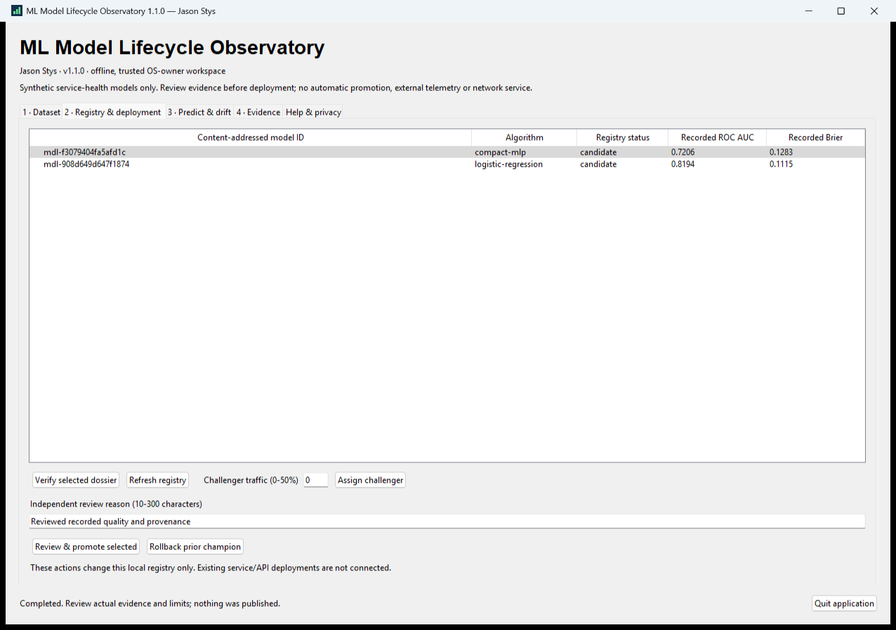
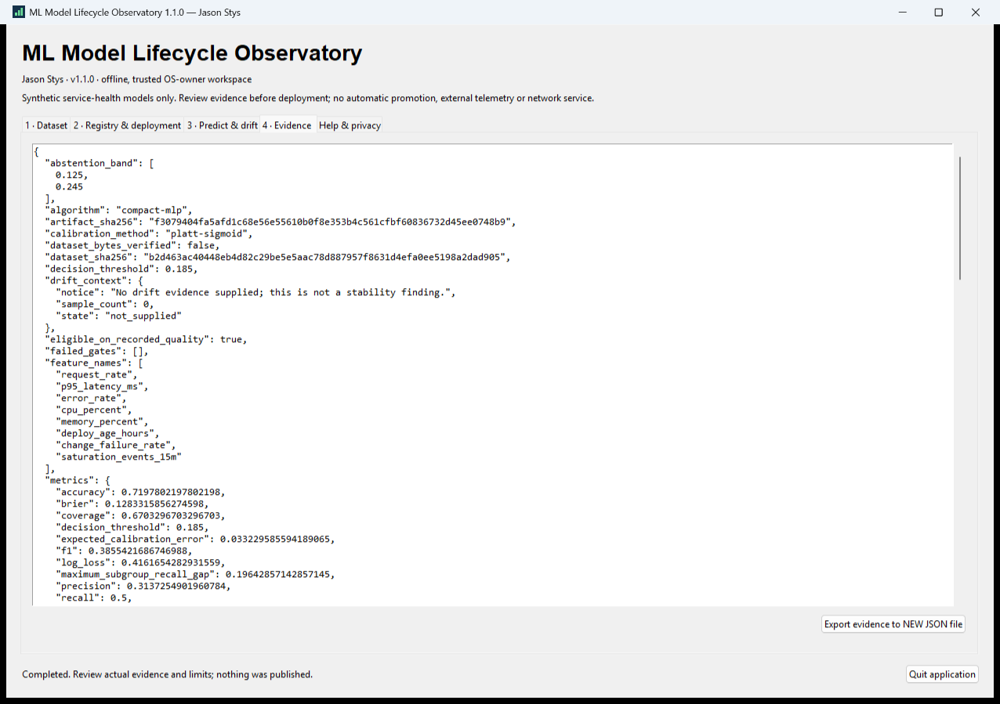

# Native model workbench

By Jason Stys. The Windows workbench calls the original model, artifact, registry and serving
code directly. It is not a separate demonstration program. The CLI, API, Docker and Kubernetes
interfaces remain available separately and retain their existing configuration contracts.

## Open and work

Extract the **entire** Windows x64 portable ZIP to a user-writable folder, keeping its
`_internal` directory, notices and `SOURCE.json`. Launch `MLModelLifecycleObservatory.exe`.
The unsigned package can produce an operating-system publisher warning; no claim of signed
distribution or independent clean-machine certification is made. This app does not require
Python, Java, Node, a browser, Docker, a paid model or an IDE to be installed by its user.

1. **Dataset:** prepare 400–4000 seeded service-health records or import an approved UTF-8
   JSON Lines file. Edit the data, then validate it. These operations do not save, train or
   promote anything. `Save & train candidates` explicitly persists valid data and executes
   the actual logistic-regression and compact-MLP training/calibration/evaluation pipeline.
2. **Registry & deployment:** select an actual model. Inspect its verified dossier before
   explicitly promoting it with a meaningful reason. Promotion reconfirms artifact hashes
   and recorded quality gates. The confirmation dialog can be canceled without deployment.
3. Select the other candidate as challenger. `0` percent means shadow only; 1–50 percent
   uses the original deterministic canary routing. This never silently changes the champion.
4. **Predict & drift:** edit a complete observation and perform a real prediction. Inspect
   champion/challenger/shadow output. Evaluate PSI against the currently edited, validated
   dataset. A drift result is review evidence, not an automatic promotion or rollback.
5. **Evidence:** inspect and export the current JSON result to a **new** file. Existing
   files are refused. Rollback separately rechecks the prior bundle and its recorded gates.

The Help & privacy tab explains every step and the trusted-owner boundary. Errors appear
in the status area. A busy operation disables mutation controls. Closing while busy requires
confirmation and retains the window/profile lock until the actual training/export operation
finishes. Canceling close leaves the application available. There is no forced worker kill
or promise that every scientific-library operation finishes within a fixed time.





These figures are actual own-window captures from the tested 1.1.0 development candidate,
not designs or screenshots from a different demonstration application.

## Durable profile and privacy

Normal Windows data is stored in
`%LOCALAPPDATA%\JasonStysPortfolio\ml-model-lifecycle-observatory\workspace`, separate
from source, executable, extracted package and Git. The new profile has an identity marker,
an exclusive retained owner lock, `dataset.jsonl`, `registry.sqlite3` and `models/`.
Only one workbench may own it. A second instance refuses it rather than resetting it.
Unknown nonempty profiles, linked state and corrupt registry identity are refused.

This is a local **single-OS-owner** workspace, not encrypted per-user storage or production
release authority. Other processes with that OS user's privileges can read its plaintext.
Keep its inputs and exports private as appropriate; exports can include supplied observations
and model evidence. Public model summaries omit the absolute artifact path. No analytics,
external requests, plugins, executable model deserialization or background API server is added.

Back up a profile only after closing the workbench. Preserve the whole directory together;
do not replace individual registry/model files. An explicit `--profile ABSOLUTE_DIRECTORY`
selects an empty or already identified profile. Missing/corrupt state is an error, not an
instruction to create a replacement over an existing directory. A failed training operation
may retain its newly validated dataset and any already registered candidates; review the
registry before retrying. There is no multi-file transaction promising all-or-nothing training.

## Bounds and interpretation

- Imports and evidence are limited to 5 MiB. Training uses 400–4000 unique JSON Lines records,
  at least 20 of each outcome, strict original feature contracts and usable held-out splits.
  Duplicate keys, nonfinite values, invalid seeds and invalid JSON are refused.
- Only the original two synthetic service-health algorithms and feature schema are supported.
  This is not a general arbitrary-model loader or a diagnosis of a real production service.
- Dossiers verify bundle/registry agreement and **recorded** metrics. They do not reread every
  original dataset byte or independently rerun the evaluation. Native rollback rechecks the
  selected prior artifact; this does not make every historical dossier entry verified.
- PSI and the core small-sample heuristic are not a statistical confidence guarantee.
- Model quality gates remain the original gates. The workbench neither invents an eligible
  model nor promotes a failed model to make a demonstration appear successful.

## Reproduce a developer candidate

Use the isolated, official patched CPython 3.14.10 Windows x64 SDK with Tcl/Tk and a fresh venv.
Install `requirements.lock`, `requirements-native.lock`, and this editable package without
dependency resolution. The packaging script requires PyInstaller 6.22.3 and coherent version
1.1.0; CI also requires a clean exact workflow checkout. No global environment changes occur.

```powershell
python -m pip install -r requirements.lock -r requirements-native.lock
python -m pip install --no-build-isolation --no-deps -e .
python scripts/build-native.py --output release/windows
python scripts/archive_native.py release/windows/MLModelLifecycleObservatory artifacts/native/windows
```

Both output/proof locations must be fresh. The second command creates the complete ZIP and
SHA-256 sidecar, checks bounded safe extraction, then launches the **extracted executable**
twice with an explicit byte-marked synthetic profile. It captures actual native controls,
executes real model operations, closes normally and verifies durable restart. It does not
open the normal workspace or install a shortcut. Runtime-only inspection is available with
`--runtime-info --runtime-info-output NEW.json`; it never opens a profile.

`native-app.yml` runs source/control tests, a clean-source build and those relocated journeys.
Ordinary push/PR runs retain only bounded JSON/PNG evidence for one day. The complete large
unsigned package is retained only after an explicit trusted-main manual opt-in. No workflow
publishes a release or uploads account data. Existing core, PostgreSQL, audit, manifest,
container and CodeQL checks remain independent required evidence.

## Native source map

| File                             | Responsibility                                                                 |
| -------------------------------- | ------------------------------------------------------------------------------ |
| `desktop/workspace.py`           | Bounded data/profile ownership and original-core lifecycle adapters.           |
| `desktop/application.py`         | Actual native tabs, editors, lifecycle confirmations and retained worker.      |
| `desktop/launcher.py`            | Product/runtime identity, normal profile selection and window lifecycle.       |
| `desktop/acceptance.py`          | Explicit marked synthetic native-control and restart acceptance only.          |
| `scripts/build-native.py`        | Patched runtime, scientific dependencies, icon, notices and provenance bundle. |
| `scripts/archive_native.py`      | Fresh bounded ZIP, safe relocation, actual extracted-product acceptance.       |
| `tests/test_native_workspace.py` | Real training/deployment/drift/durable state and refusal regressions.          |
| `tests/test_native_identity.py`  | Frozen identity, strict marker and exclusive runtime-report contracts.         |
| `tests/test_native_archive.py`   | Actual ZIP traversal/device/link/collision/budget and marker regressions.      |
| `native_tests/test_widgets.py`   | Actual controls, cancellation, retained worker/profile and layout tests.       |
| `requirements-native.lock`       | Exact independent native build tools; original dependency lock is preserved.   |

Exact declarations and important constants are indexed in [code-index.md](code-index.md).
